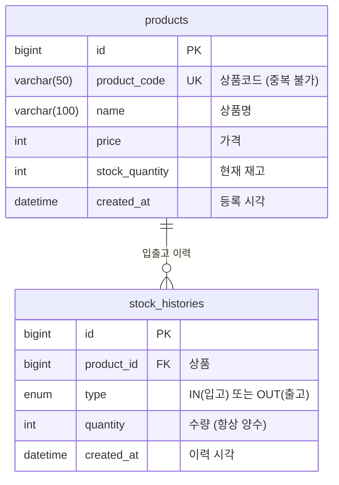

# 재고 관리 REST API

생산 현장의 **상품(자재·제품) 정보와 입고·출고 이력을 관리하는 REST API**입니다.
Spring Boot와 JPA로 만들었고, 재고가 음수가 되지 않도록 막는 규칙과 재고·이력의 일관성(트랜잭션), 통일된 에러 응답, 테스트에 신경 썼습니다.

- 상품 등록·조회·수정·삭제, 상품명·코드 검색, 페이징
- 입고·출고로 재고를 변경하고 이력을 남김 (재고보다 많이 출고 불가)
- 재고 부족 상품 조회
- Swagger UI로 API 문서 제공 (`/swagger-ui.html`)

## 데모 서버

**https://inventory-api-zvz1.onrender.com** (접속하면 Swagger UI로 이동합니다. 직접 요청을 보내 볼 수 있습니다.)

- **무료 서버라서 15분 이상 접속이 없으면 잠듭니다.** 잠든 뒤의 **첫 접속은 약 1분 20초**(실측 84초) 걸리고, 깨어난 뒤에는 0.5초 안팎으로 응답합니다. 처음 열었을 때 화면이 오래 안 뜨면 잠시만 기다려 주세요.
- 누구나 등록·수정·삭제를 시험해 볼 수 있는 **데모용**입니다. 데이터는 예고 없이 초기화될 수 있습니다.
- 앱은 [Render](https://render.com)(Docker), DB는 [TiDB Cloud](https://www.pingcap.com/tidb-cloud/) Starter(MySQL 호환)에서 실행됩니다. 자세한 내용은 아래 "배포" 섹션을 참고하세요.

## 기술 스택

| 구분 | 사용 기술 |
|---|---|
| 언어 | Java 21 |
| 프레임워크 | Spring Boot 4.1.2 (Spring Web MVC, Spring Data JPA, Validation) |
| ORM | JPA / Hibernate 7 |
| DB | MySQL 8.4 |
| 빌드 | Gradle (Wrapper 포함) |
| API 문서 | springdoc-openapi 3.2.0 (Swagger UI) |
| 테스트 | JUnit, Mockito, AssertJ, H2(테스트 전용 인메모리 DB), Postman |
| 기타 | Lombok |

## 주요 기능

| 기능 | 설명 |
|---|---|
| 상품 CRUD | 상품코드는 중복 불가. 수정은 이름·가격만 가능하고, 재고는 입고·출고로만 변경 |
| 검색·페이징 | `keyword`로 상품명·상품코드 부분 일치 검색(대소문자 무시), `page`·`size`로 페이징 |
| 재고 부족 조회 | 재고가 기준값 이하인 상품을 재고가 적은 순으로 조회 |
| 입고·출고 | 재고 변경과 이력 저장을 **하나의 트랜잭션**으로 처리. 재고보다 많이 출고하면 거절하고 아무것도 바뀌지 않음 |
| 입출고 이력 | 상품별 이력을 최신순으로 조회 |
| 통일된 에러 응답 | 모든 오류를 `status`, `code`, `message` 형식의 JSON으로 응답 |

## 실행 방법

### 준비물
- JDK 21
- MySQL 8.x

### 1. 저장소 받기
```bash
git clone https://github.com/strawberryroll/inventory-api.git
cd inventory-api
```

### 2. 데이터베이스 만들기
MySQL에 접속해서 `inventory` 데이터베이스를 만듭니다. 테이블은 앱을 처음 실행할 때 자동으로 생성됩니다(`ddl-auto: update`, 개발용 설정).
```sql
CREATE DATABASE inventory CHARACTER SET utf8mb4;
```
접속 주소는 `src/main/resources/application.yaml`의 `jdbc:mysql://localhost:3306/inventory`입니다. 다른 주소를 쓴다면 이 파일을 수정하세요.

### 3. 환경변수 설정 후 실행
DB 비밀번호는 코드에 적지 않고 **환경변수**로 받습니다.

| 환경변수 | 설명 | 기본값 |
|---|---|---|
| `DB_PASSWORD` | MySQL 비밀번호 (필수) | 없음 |
| `DB_USERNAME` | MySQL 사용자명 | `root` |

```bash
DB_PASSWORD='내MySQL비밀번호' ./gradlew bootRun
```
IntelliJ에서 실행한다면 실행 구성(Run Configuration)의 Environment variables에 `DB_PASSWORD=...`를 넣으면 됩니다.

### 4. 확인
| 주소 | 설명 |
|---|---|
| http://localhost:8080/swagger-ui.html | Swagger UI (API 문서, 직접 호출해 볼 수 있음) |
| http://localhost:8080/v3/api-docs | OpenAPI 명세 (JSON) |
| http://localhost:8080/hello | 서버 동작 확인용 |

## Docker로 실행하기

MySQL을 따로 설치하지 않아도 **앱과 DB를 한 번에** 실행할 수 있습니다. ([Docker Desktop](https://www.docker.com/products/docker-desktop/) 필요)

```bash
cp .env.example .env        # .env 파일을 열어 DB_PASSWORD 값을 채웁니다
docker compose up --build
```

- 접속: http://localhost:8080/swagger-ui.html
- 내 컴퓨터에서 이미 8080 포트를 쓰고 있다면 `APP_PORT=8081 docker compose up --build`처럼 바꿔서 실행하세요.
- 중지: `docker compose down` (데이터는 유지) / 데이터까지 삭제: `docker compose down -v`
- `.env`는 Git에 올라가지 않습니다. 비밀번호는 이 파일(또는 환경변수 `DB_PASSWORD`)로만 전달합니다.
- `docker-compose.yml`은 앱의 메모리를 512MB로 제한해서 무료 배포 서버와 비슷한 조건으로 실행합니다. 이 조건에서도 전체 Postman Collection이 통과합니다.

### 배포용 환경변수

| 환경변수 | 설명 |
|---|---|
| `SPRING_PROFILES_ACTIVE` | `prod`로 두면 배포용 설정(`application-prod.yaml`)이 적용됩니다: SQL 로그 끄기, DB 연결 수 5개로 제한, 프록시 뒤에서 https 인식 |
| `DB_URL` | MySQL JDBC 주소. 없으면 `jdbc:mysql://localhost:3306/inventory...` (외부 DB는 보통 SSL 옵션이 필요) |
| `DB_USERNAME` | DB 사용자명 (기본 `root`) |
| `DB_PASSWORD` | DB 비밀번호 (필수) |
| `PORT` | 서버 포트. 배포 플랫폼이 지정해 주며, 없으면 8080 |

## 테스트

### 자동 테스트 (JUnit)
```bash
./gradlew test
```
**MySQL이나 환경변수 없이** 실행됩니다. 통합 테스트는 테스트 전용 인메모리 DB(H2)를 사용합니다. 총 43개입니다.

| 종류 | 개수 | 내용 |
|---|---|---|
| 단위 테스트 | 27 | 재고 규칙(엔티티), Service 로직을 Mockito로 검증. DB를 사용하지 않음 |
| 통합 테스트 | 15 | 실제 서버와 H2 DB로 입출고 동작, 생성된 API 문서의 내용, 루트 주소 이동 검증 |
| 시동 테스트 | 1 | 앱이 정상적으로 시작되는지 확인 |

### API 테스트 (Postman)
`docs/postman/`에 Postman Collection이 있습니다. 앱을 실행한 상태에서 사용합니다.

| 파일 | 내용 |
|---|---|
| `inventory-api.postman_collection.json` | 전체 API 테스트 (요청 77개, 검증 191개). 정상 흐름, 입력 검증, 오류 응답, 페이징·검색, API 문서까지 확인 |
| `inventory-seed.postman_collection.json` | 테스트용 상품 12개(`S-001`~`S-012`) 등록 |

Postman에서 **Import**한 뒤 Collection의 **Run**을 누르거나, Postman CLI로 실행합니다.
```bash
postman collection run docs/postman/inventory-api.postman_collection.json
```
> 개발용 DB에서만 실행하세요. 실행할 때마다 입출고 이력이 있는 테스트 상품이 하나씩 남습니다.

## API 목록

| 기능 | 메서드 | URL | 성공 | 주요 오류 |
|---|---|---|---|---|
| 상품 등록 | POST | `/api/products` | 201 | 400, 409 |
| 상품 목록·검색 | GET | `/api/products?keyword=&page=&size=` | 200 | - |
| 상품 단건 조회 | GET | `/api/products/{id}` | 200 | 400, 404 |
| 상품 수정 | PUT | `/api/products/{id}` | 200 | 400, 404 |
| 상품 삭제 | DELETE | `/api/products/{id}` | 204 | 404, 409 |
| 재고 부족 조회 | GET | `/api/products/low-stock?threshold=10&page=&size=` | 200 | 400 |
| 입고 | POST | `/api/products/{id}/stock-in` | 200 | 400, 404 |
| 출고 | POST | `/api/products/{id}/stock-out` | 200 | 400, 404 |
| 입출고 이력 조회 | GET | `/api/products/{id}/stock-histories` | 200 | 404 |

- **페이징**: `page`는 0부터 시작하고, `size`는 기본 10, 최대 100입니다. 정렬은 서버에서 고정합니다(목록·검색은 최신 등록순, 재고 부족 조회는 재고가 적은 순). `sort` 파라미터는 무시됩니다.
- **삭제**: 입출고 이력이 있는 상품은 삭제할 수 없습니다(`409`).
- 상세한 요청·응답 형식은 Swagger UI에서 확인할 수 있습니다.

## 요청·응답 예시

아래 응답은 실제로 앱을 실행해 받은 결과입니다.

### 상품 등록 `POST /api/products`
```json
{
  "productCode": "P-001",
  "name": "볼트 M8",
  "price": 500,
  "stockQuantity": 100
}
```
성공하면 `201 Created`와 함께 아래 단건 조회와 같은 형식의 상품 정보를 돌려줍니다.

### 상품 단건 조회 `GET /api/products/6`
```json
{
  "id": 6,
  "productCode": "S-001",
  "name": "볼트 M6",
  "price": 100,
  "stockQuantity": 5,
  "createdAt": "2026-10-28T14:52:21.985745"
}
```

### 재고 부족 조회 `GET /api/products/low-stock?threshold=10&size=3`
재고가 적은 순서로 정렬되고, 목록·검색 API도 같은 페이징 응답 형식을 사용합니다.
```json
{
  "content": [
    { "id": 14, "productCode": "S-009", "name": "와셔 L", "price": 900, "stockQuantity": 0, "createdAt": "2026-10-28T14:52:22.1023" },
    { "id": 10, "productCode": "S-005", "name": "너트 M8", "price": 500, "stockQuantity": 3, "createdAt": "2026-10-28T14:52:22.048023" },
    { "id": 6, "productCode": "S-001", "name": "볼트 M6", "price": 100, "stockQuantity": 5, "createdAt": "2026-10-28T14:52:21.985745" }
  ],
  "page": 0,
  "size": 3,
  "totalElements": 6,
  "totalPages": 2
}
```

### 입고·출고 `POST /api/products/{id}/stock-in`, `/stock-out`
요청은 수량 하나입니다. 성공하면 변경된 재고가 담긴 상품 정보를 돌려주고, 재고와 입출고 이력이 함께 저장됩니다.
```json
{ "quantity": 10 }
```

### 입출고 이력 조회 `GET /api/products/{id}/stock-histories`
최신순으로 돌려주고, 이력이 없으면 빈 배열(`[]`)입니다.
```json
[
  { "id": 10, "productId": 25, "type": "OUT", "quantity": 15, "createdAt": "2026-10-29T00:30:41.685092" },
  { "id": 9, "productId": 25, "type": "IN", "quantity": 30, "createdAt": "2026-10-29T00:30:41.669995" }
]
```

## 에러 응답

모든 오류는 같은 형식으로 응답합니다. `message`는 사람이 읽는 설명이고, 클라이언트는 안정적인 `code`로 분기하면 됩니다.

| code | HTTP | 발생 상황 |
|---|---|---|
| `PRODUCT_NOT_FOUND` | 404 | 없는 상품 |
| `DUPLICATE_PRODUCT_CODE` | 409 | 이미 있는 상품코드로 등록 |
| `INSUFFICIENT_STOCK` | 400 | 재고보다 많이 출고 |
| `PRODUCT_HAS_HISTORY` | 409 | 입출고 이력이 있는 상품 삭제 |
| `INVALID_INPUT` | 400 | 입력값 오류(검증 실패, 숫자 자리에 문자 등) |
| `INVALID_REQUEST_BODY` | 400 | 요청 본문을 읽을 수 없음(JSON 형식 오류 등) |
| `DATA_INTEGRITY_VIOLATION` | 409 | 그 밖의 DB 제약 위반 |

**재고 부족** `POST /api/products/6/stock-out` (재고 5, 수량 1000000)
```json
{
  "status": 400,
  "code": "INSUFFICIENT_STOCK",
  "message": "재고가 부족합니다. 현재 재고=5, 요청 수량=1000000"
}
```

**입력 검증 실패** `POST /api/products` — 어느 필드가 왜 틀렸는지 `errors`로 알려 줍니다.
```json
{
  "status": 400,
  "code": "INVALID_INPUT",
  "message": "입력값이 올바르지 않습니다",
  "errors": [
    { "field": "name", "message": "상품명은 필수입니다" },
    { "field": "productCode", "message": "상품코드는 필수입니다" },
    { "field": "price", "message": "가격은 0 이상이어야 합니다" }
  ]
}
```

## 프로젝트 구조

요청이 `Controller → Service → Repository → DB` 순서로 흐르고, 계층마다 역할을 나눴습니다.

```text
com.example.inventory
├── controller   요청을 받고 응답 상태 코드를 정함 (ProductController, StockController)
├── service      비즈니스 규칙과 트랜잭션 (ProductService, StockService)
├── repository   DB 접근, Spring Data JPA (ProductRepository, StockHistoryRepository)
├── domain       엔티티: DB 테이블과 매핑, 재고 규칙을 직접 가짐 (Product, StockHistory, StockType)
├── dto          요청·응답 전용 객체 (엔티티를 외부에 직접 노출하지 않음)
├── exception    ErrorCode, BusinessException과 자식 예외, 전역 예외 처리(GlobalExceptionHandler)
└── config       Swagger 문서 설정 (OpenApiConfig)
```

```text
src/test
├── domain, service   단위 테스트 (Mockito, DB 없음)
├── integration       통합 테스트 (실제 서버 + H2)
└── resources         테스트 전용 설정 (application-test.yaml)
```

## 테이블 구조 (ERD)



- 현재 재고는 `products.stock_quantity`에 보관하고, 재고가 변할 때마다 `stock_histories`에 그 기록을 남깁니다. 수량은 항상 양수이고 증가·감소는 `type`으로 구분합니다.
- 이력은 상품을 참조하지만 상품은 이력 목록을 갖지 않는 **단방향** 관계입니다. 상품별 이력은 `product_id`로 조회합니다.
- 컬럼 타입은 엔티티 정의를 기준으로 그린 논리 구조이고, 실제 DB의 타입은 DBMS에 따라 조금 다를 수 있습니다. MySQL 호환 DB(TiDB)에 테이블을 만들 때 Hibernate가 출력한 DDL에서 `type`이 `enum('IN','OUT')`으로 생성되는 것을 확인했습니다.

## 설계 포인트와 고민한 점

### 1. 재고가 음수가 되지 않게 하고, 재고와 이력을 함께 반영하기
- **검사 위치**: 출고 규칙을 Service가 아니라 엔티티 메서드 `Product.decreaseStock()`에 두었습니다. 어디서 호출해도 이 검사를 건너뛸 수 없습니다. 재고와 같은 수량은 출고되어 0이 되고, 1개라도 초과하면 거절합니다.
- **일관성**: 재고(`products`)와 이력(`stock_histories`)은 `@Transactional`로 한 번에 처리해서, 재고만 바뀌고 이력이 없는 상태가 남지 않게 했습니다.
- **우회 차단**: 요청 DTO의 `@Positive`로 음수·0 수량을 막아 재고 검사를 우회하지 못하게 했습니다.
- **검증**: 경계값(재고 10에서 10 출고, 11 출고)을 단위 테스트로, 재고 부족 시 DB의 재고가 그대로이고 이력이 0건인 것을 통합 테스트(H2)로 확인했습니다. 코드를 일부러 망가뜨려(`<`를 `<=`로 변경) 테스트가 실제로 실패하는지, `@Transactional`을 빼면 입고 통합 테스트가 실패하는지도 확인했습니다.
- **한계**: 같은 상품에 두 요청이 **동시에** 출고하면 둘 다 재고 검사를 통과할 수 있습니다(개선 예정). 또한 JPA는 재고 `UPDATE`를 트랜잭션이 끝날 때 실행하므로, "이미 실행된 `UPDATE`를 되돌리는 롤백 자체"를 증명하는 테스트는 아직 없습니다.

### 2. 입력 검증과 `int` 대신 `Integer`
요청 DTO를 처음에 `int`로 만들었더니, 수량을 빠뜨린 요청(`{}`)이 검증에 도달하지 못하고 "본문을 읽을 수 없음"이라는 모호한 오류로 끝났습니다. JSON 변환기가 기본 타입 필드의 누락을 거부했기 때문입니다. `Integer`와 `@NotNull`로 바꿔서 어느 필드가 문제인지 `errors` 목록으로 알려 주도록 고쳤습니다. Postman 테스트를 만들다가 발견한 문제입니다.

### 3. 에러 응답 통일과 구조 개선
오류를 `status`, `code`, `message` 형식의 JSON으로 통일했습니다. 처음에는 예외마다 `@ExceptionHandler` 메서드를 만들었는데 예외가 늘수록 핸들러도 늘어서(7개), `ErrorCode` enum과 공통 부모 `BusinessException`으로 리팩터링했습니다(4개). 새 에러는 enum 항목 하나만 추가하면 되고 핸들러는 고치지 않습니다. 응답이 바뀌지 않았음은 기존 Postman 시나리오를 다시 실행해 확인했습니다. 메시지는 문장이라 바뀔 수 있으므로 클라이언트는 안정적인 `code`로 분기하도록 했습니다.

### 4. 중복과 무결성을 두 겹으로 방어하기
- 상품코드 중복은 **사전 검사**(친절한 `409` 메시지)와 DB의 **unique 제약**(동시 요청까지 막는 마지막 방어선)을 함께 씁니다. 사전 검사를 통과한 뒤 DB 제약에 걸리면 같은 `DUPLICATE_PRODUCT_CODE`로 변환합니다.
- 입출고 이력이 있는 상품은 삭제할 수 없게(`409`) 했습니다. 이력은 재고 변동의 근거여서 상품과 함께 사라지면 안 된다고 판단했습니다. 이력까지 함께 지우는 방법은 이력 소실 위험이 있고, 삭제 대신 비활성화하는 소프트 삭제는 범위가 커서 개선 예정으로 남겼습니다.
- 동시 요청 방어 코드는 예외 변환 로직을 단위 테스트로 확인했고, 실제 동시 요청으로 재현해 보지는 않았습니다.

### 5. API 설계 선택
- **페이징 응답을 직접 정의**(`PageResponse`)해서 Spring `Page`의 직렬화 형태나 버전에 JSON이 좌우되지 않게 했습니다.
- 클라이언트가 보낸 `sort`는 **무시하고 서버에서 정렬을 고정**했습니다. 없는 필드로 정렬을 요청하면 `500`이 나는 문제를 막고, 재고 부족 조회는 급한 것부터 보이도록 재고 오름차순으로 정했습니다.
- 검색어의 `%`가 와일드카드로 해석되지 않고 문자 그대로 검색되는 것을 확인했습니다. `/api/products/low-stock`과 `/api/products/{id}`가 충돌하지 않는 것도 테스트로 확인했습니다.
- 숫자 자리에 문자가 들어간 파라미터(`threshold=abc`, `/api/products/abc`)도 같은 에러 형식으로 응답합니다.

### 6. 테스트를 세 겹으로 쌓기
1. **단위 테스트(Mockito)**: DB 없이 Service와 엔티티의 판단 로직을 검증합니다. "재고 부족이면 이력 저장이 호출되지 않는다" 같은 것을 확인합니다.
2. **통합 테스트(H2)**: 실제 서버와 DB로 입출고 결과를 확인합니다. 테스트 전용 설정(`test` 프로파일)을 분리해서 `./gradlew test`가 MySQL과 비밀번호 없이 어디서나 돌아가게 했습니다.
3. **API 테스트(Postman, 77개 요청)**: 실제 MySQL로 띄운 앱을 대상으로 정상 흐름, 입력 검증, 오류 응답, 페이징·검색을 확인합니다. CLI로 한 번에 실행할 수 있어 기능을 고친 뒤 회귀를 빠르게 확인했습니다.

API 문서도 테스트합니다. Swagger 명세를 만든 뒤 직접 열어 보니 성공 응답이 빠진 API가 6개, 서버 확인용 API가 노출된 것을 발견해서 고치고, 같은 문제가 재발하지 않도록 명세를 검사하는 테스트를 추가했습니다.

### 7. 배포하면서 겪은 일
- **DB와 앱을 분리**했습니다. 로컬에서는 `docker compose`로 앱과 MySQL을 함께 띄우고, 배포에서는 앱은 Render, DB는 TiDB Cloud로 나눴습니다. 접속 주소·사용자·비밀번호를 환경변수(`DB_URL` 등)로 받게 해 두어서 코드 변경 없이 같은 이미지를 어디서든 쓸 수 있었습니다.
- **외부 DB는 암호화 연결이 필수**여서 로컬에서 쓰던 `useSSL=false`를 쓸 수 없었습니다. 배포 전에 내 컴퓨터의 앱을 클라우드 DB에 먼저 연결해 보고(`sslMode=VERIFY_IDENTITY`), 같은 값을 Render에 넣는 순서로 문제를 줄였습니다.
- **무료 서버의 한계를 미리 측정**했습니다. Docker로 CPU 0.1, 메모리 512MB 조건을 흉내 내자 시작에 약 194초가 걸렸고, JVM 옵션(`-XX:TieredStopAtLevel=1`)으로 약 97초까지 줄였습니다. 실제 Render에서 잠든 뒤 첫 접속은 84초였습니다. 잠드는 서버의 구조적인 한계라서 README에 안내문으로 남겼습니다.
- **프록시 뒤에서 동작하도록** 설정했습니다(`forward-headers-strategy`). 배포 환경에서는 앞단이 https를 받아 앱에는 http로 전달하는데, 이 설정이 있어서 Swagger가 `https` 주소를 쓰는 것을 실제 배포 주소에서 확인했습니다.
- **첫인상**: 배포 주소로 들어가면 404 오류 화면이 보이는 문제를 발견해서, 루트(`/`) 접속 시 Swagger UI로 이동하게 했습니다.
- 배포된 서버에 Postman Collection을 실행하다가, 일부 테스트가 **다른 폴더가 만든 데이터에 의존**하는 설계 약점을 발견했습니다. 각 폴더가 필요한 데이터를 스스로 만들고 지우도록 고쳐서, 폴더를 골라 실행해도 통과합니다.

### 8. 설정과 비밀 관리
DB 비밀번호는 코드와 Git에 두지 않고 환경변수(`DB_PASSWORD`)로 받습니다. `ddl-auto: update`는 개발 편의를 위한 설정입니다(아래 개선 예정 참고).

## 개선 예정

| 항목 | 내용 |
|---|---|
| 동시성 제어 | 같은 상품의 동시 출고 시 재고가 음수가 될 수 있음. 비관적 락(`@Lock`) 또는 낙관적 락(`@Version`) 적용 |
| 롤백 검증 강화 | 이미 실행된 `UPDATE`가 롤백되는 것까지 증명하는 테스트, MySQL을 쓰는 Testcontainers 통합 테스트 |
| 소프트 삭제 | 이력이 있는 상품을 삭제하는 대신 사용 중지로 처리 |
| 정렬 옵션 | 허용된 필드에 한해 클라이언트가 정렬을 선택할 수 있게 확장 |
| 검색 성능 | `LIKE '%키워드%'`는 인덱스를 쓰지 못함. 데이터가 많아지면 FULLTEXT 인덱스 등을 검토 |
| 운영 환경 설정 | Swagger UI 비활성화, `ddl-auto`를 `validate`로 바꾸고 DB 마이그레이션 도구(Flyway 등) 도입 |
| 인증·인가 | 현재는 누구나 호출 가능. 역할별 권한 도입 |
| 배포 | GitHub Actions로 테스트 자동 실행, AWS(EC2·RDS 등)로 이전해 보기, 잠든 뒤 첫 접속 지연(콜드 스타트) 완화 |
| 다른 DB 전환 | Oracle, MSSQL 등으로 전환해도 동작하는지 검증 (JPA 덕분에 이식성은 높을 것으로 예상하나 아직 확인하지 않음) |
